# WABA DevTools (`waba`)

Retrieve and deploy or bulk-CSV-import **WhatsApp Business message templates** across several WhatsApp
Business Accounts (WABAs) — for example one WABA per pipeline stage (dev → qa → prod).

- Keep templates as JSON files in git and deploy them to every WABA of a stage.
- Copy templates straight from one stage's WABA to the next.
- Bulk-upsert template texts from a Google Sheets (CSV) export.
- Create what is missing, update what changed, leave the rest alone — a second deploy sends nothing.

It talks to Meta's Graph API directly and needs no other tool.

## Install

```bash
npm install -g waba-devtools
waba --help
```

Node.js `^22.22.2 || >=24.15.0`.

## Quick start

Before you start, you need:

- the **WABA IDs** — shown in
  [Business settings](https://business.facebook.com/settings) → **Accounts** → **WhatsApp
  accounts**, or found for you by [`waba discover`](#discover) once you have a token;
- an **access token** per environment — see [Access tokens](#access-tokens) for the steps.

Official Meta documentation:

| Topic                                     | Link                                                                                                                                   |
| ----------------------------------------- | -------------------------------------------------------------------------------------------------------------------------------------- |
| Access tokens (system users)              | [Access tokens](https://developers.facebook.com/documentation/business-messaging/whatsapp/access-tokens)                               |
| Creating the Meta app                     | [WhatsApp use case](https://developers.facebook.com/documentation/development/create-an-app/whatsapp-use-case)                         |
| Permissions                               | [Permissions](https://developers.facebook.com/documentation/business-messaging/whatsapp/permissions)                                   |
| Message templates                         | [Template fundamentals](https://developers.facebook.com/documentation/business-messaging/whatsapp/templates/overview)                  |
| Template categories (Utility / Marketing) | [Template categorization](https://developers.facebook.com/documentation/business-messaging/whatsapp/templates/template-categorization) |
| Template review by Meta                   | [Template review](https://developers.facebook.com/documentation/business-messaging/whatsapp/templates/template-review/)                |

1. Create `.wabadevrc.json` in your project folder:

   ```json
   {
     "stages": {
       "dev": [{ "wabaId": "111111111111111", "tokenEnv": "WABA_TOKEN_NONPROD" }],
       "qa": [{ "wabaId": "222222222222222", "tokenEnv": "WABA_TOKEN_NONPROD" }],
       "prod": [
         { "wabaId": "333333333333333", "tokenEnv": "WABA_TOKEN_PROD" },
         { "wabaId": "444444444444444", "tokenEnv": "WABA_TOKEN_PROD" }
       ]
     }
   }
   ```

2. Put the tokens into a `.env` file next to it (and add `.env` to `.gitignore`):

   ```text
   WABA_TOKEN_NONPROD=EAAG...
   WABA_TOKEN_PROD=EAAG...
   ```

3. Check access, retrieve, preview, deploy:

   ```bash
   waba check
   waba retrieve --from dev
   waba deploy --to qa --dry-run
   waba deploy --to qa
   ```

   Without a global install, use `npx -p waba-devtools waba check`. Plain `npx waba` could fetch an
   unrelated npm package named `waba` instead.

### Access tokens

`waba` needs a **System User access token** from the Meta business portfolio that owns your
WABAs. One-time setup (≈ 15 min), done by an admin of that portfolio. The labels below are Meta's
English ones (German in brackets). Meta follows your language setting; adding `&locale=en_US` to a
Business settings address shows it in English without changing your settings.

**Before you start, note your business portfolio ID:** open
[Business settings](https://business.facebook.com/latest/settings), check the portfolio name at the
top left, and copy the number after `business_id=` in the address bar. You need it in step 2 and
for `waba discover`.

1. **Create a Meta app** — skip if the portfolio already has one for this. A token always belongs to
   an app, also when your WABAs were connected through a provider such as Salesforce.
   - [developers.facebook.com/apps](https://developers.facebook.com/apps) → **Create App** → app
     name and e-mail.
   - Use case: **Connect with customers through WhatsApp** → **Next**.
   - Business portfolio: the one that owns your WABAs. Skip the publishing requirements with
     **Next**, review, **Create app**.
2. **Create a system user.**
   - Open `https://business.facebook.com/latest/settings/system_users?business_id=<portfolio id>&locale=en_US`
     (or **Settings** → **Users** → **System users** [_Nutzer → Systemnutzer_]).
   - **+ Add** [_+ Hinzufügen_] (top right). The first time, Meta asks you to accept its
     non-discrimination policy for system users (**I accept**).
     <details><summary>Screenshot</summary>

     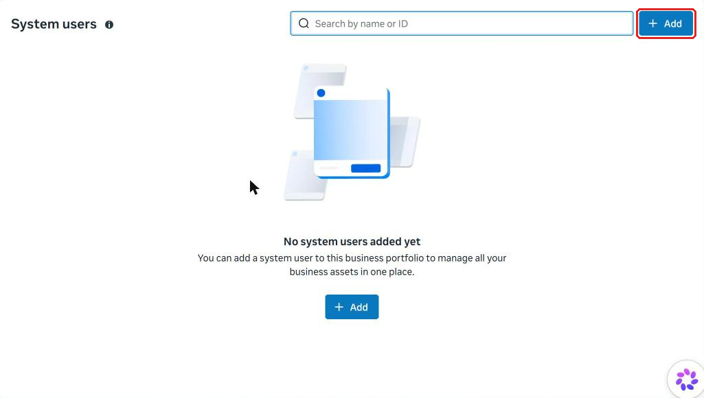

     </details>

   - Name, e.g. `wabadev-nonprod`, role **Employee** — it then only sees what you assign →
     **Create system user**.
     <details><summary>Screenshot</summary>

     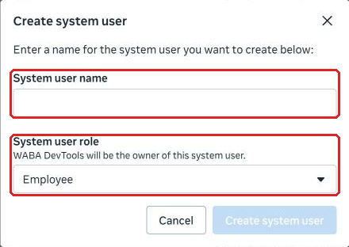

     </details>
3. **Give the system user the app and the WABAs** — as little as `waba` needs.
   - Select the system user. **Assign assets** [_Assets zuweisen_] is hidden in the **⋯** menu
     next to **Generate token** and **Revoke tokens**.
     <details><summary>Screenshot</summary>

     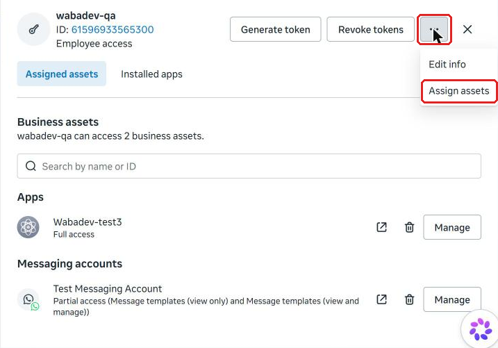

     </details>

   - The dialog **Select assets and assign permissions** has the asset types on the left. Tick the
     asset, then switch on its permission on the right:
     - **Apps** → your app → **Partial access: Test app**. That is enough to create the token (see
       [Why the app?](#why-does-the-system-user-need-the-app) below).
       <details><summary>Screenshot</summary>

       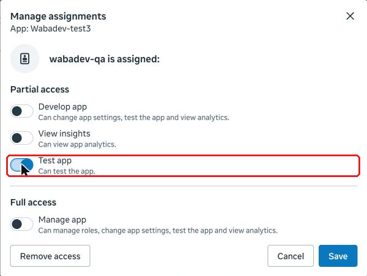

       </details>

     - **Messaging accounts → Linked accounts** → each WABA this token should reach →
       **Partial access: Message templates (view and manage)**. It covers everything `waba`
       does; _Everything_ would also allow sending messages and seeing payment details. Careful:
       the separate entry **WhatsApp accounts** [_WhatsApp-Konten_] lists other objects — the WABAs
       are under _Messaging accounts_.
       <details><summary>Screenshot</summary>

       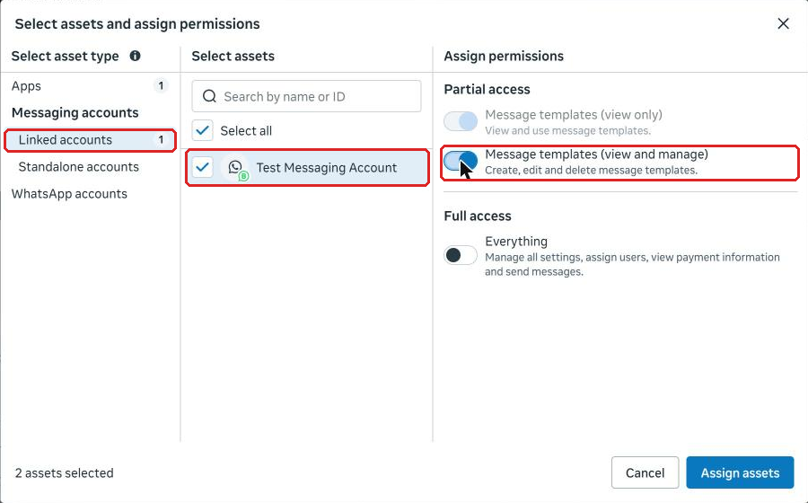

       </details>

   - **Assign assets**. Check the tab **Assigned assets** [_Zugewiesene Assets_]: your app with
     _Partial access (Test app)_, every WABA with _Message templates (view and manage)_.
     <details><summary>Screenshot</summary>

     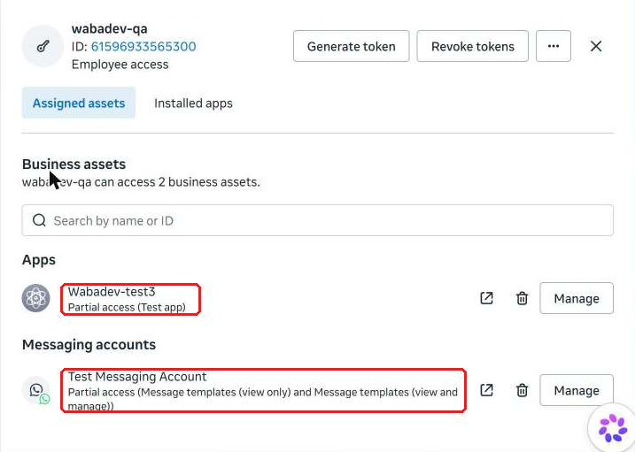

     </details>

4. **Generate the token** — **Generate token** [_Token generieren_], four steps:
   - **Select app** [_App auswählen_] → your app → **Next**.
     <details><summary>Screenshot</summary>

     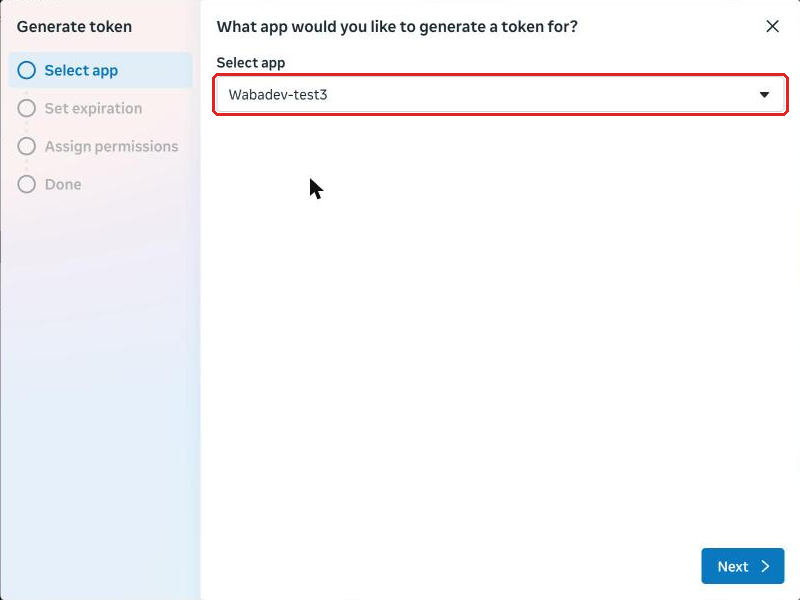

     </details>

   - **Set expiration** [_Ablaufdatum festlegen_]: pick **Never** [_Nie_]. Meta preselects _60 days_;
     the token then simply stops working after two months.
     <details><summary>Screenshot</summary>

     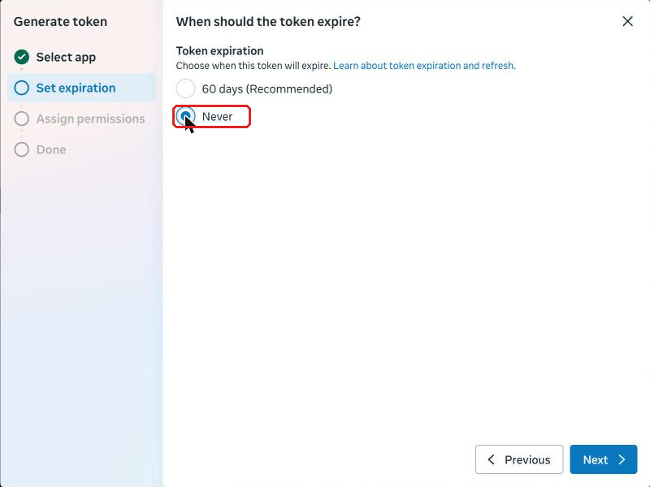

     </details>

   - **Assign permissions** [_Berechtigungen zuweisen_]: `whatsapp_business_management` only —
     no `whatsapp_business_messaging`, as `waba` never sends messages. Add
     `business_management` only if you want [`discover`](#discover) to find your WABAs (see below).
     Then **Generate token**.
     <details><summary>Screenshot</summary>

     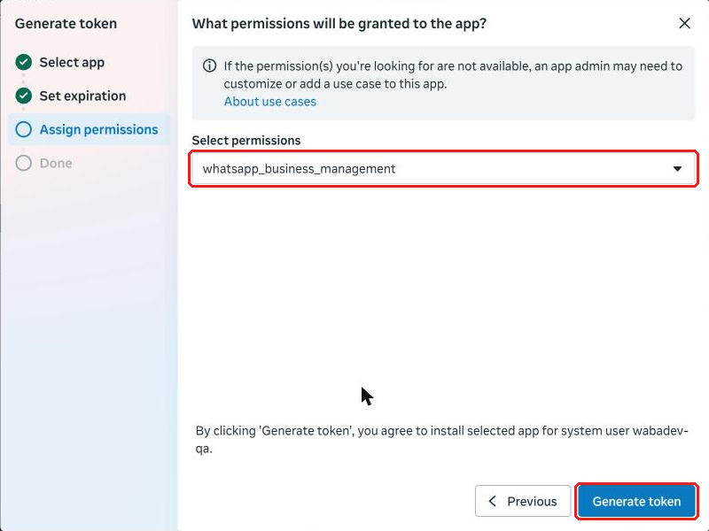

     </details>

   - **Done**: copy the token with Meta's **Copy** button — not by selecting the text, which can copy
     parts twice. Meta shows the token only once.

5. **Store and test it.**
   - Put it into `.env` as **one** line: `WABA_TOKEN_NONPROD=EAA…`.
   - Put the WABA IDs into `.wabadevrc.json`, then run `waba check`. The ID is under the name in
     **Settings → Accounts → Messaging accounts**
     (`https://business.facebook.com/latest/settings/whatsapp_account?business_id=<portfolio id>`).
     <details><summary>Screenshot</summary>

     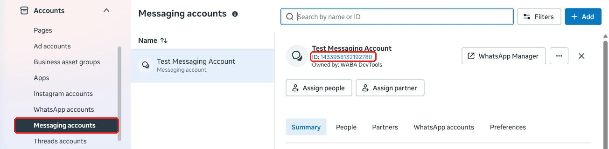

     </details>

#### Why does the system user need the app?

The WABA permission decides **what** a token may change; the app decides **whether a token can
exist at all** — every Meta access token is issued for an app. Without an app role, **Generate
token** lists the app but stops at _Assign permissions_ with "No permissions available — Assign an
app role to the system user". The smallest role, **Test app**, removes that block (tested
2026-11-22). _Manage app_ is not needed; it would let the token's owner change the app itself.

<details><summary>Screenshot: Generate token without an app role</summary>

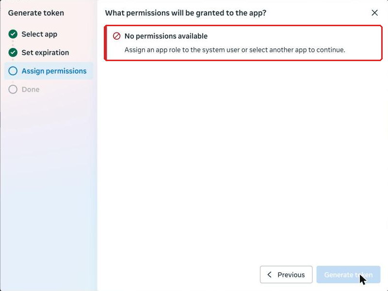

</details>

#### What the minimal setup can and cannot do

| Setup                                                                                                 | `check`, `list`, `retrieve`, `deploy`, `backup`, `compare` | `discover`                         |
| ----------------------------------------------------------------------------------------------------- | ---------------------------------------------------------- | ---------------------------------- |
| App: Test app · WABA: Message templates (view and manage) · permission `whatsapp_business_management` | ✓                                                          | ✗                                  |
| … plus app **Develop app** and permission `business_management`                                       | ✓                                                          | ✓ with `--business <portfolio id>` |

`discover` asks Meta to describe the token; Meta answers only when the system user can develop the
app, and it lists a portfolio's WABAs only with `business_management`. A new app may not offer
`business_management` yet: add it in the app dashboard under **Use cases → Customize → Permissions
and features**. If you know your WABA IDs, you do not need `discover` at all.

To **revoke** a token (e.g. after it was shared by mistake): select the system user → **Revoke
tokens** [_Tokens widerrufen_] → then generate a new one.

For production, repeat steps 2–5 with a second system user (e.g. `wabadev-prod`) that only gets the
prod WABAs. Then a non-production token can never change production.

A system user only reaches WABAs of **its own** portfolio. If your WABAs sit in several portfolios,
create a system user and token in each and give each stage the matching `tokenEnv`.

Where the token lives:

- **Locally:** a `.env` file in the project folder. `waba` loads it on start; variables that are
  already set in your shell win.
- **CI/CD:** a secret of your pipeline, exposed as the environment variable named in `tokenEnv`.
- Tokens are never written to files, reports or `--json` output.

WABAs connected through a provider (for example Salesforce) are still owned by your portfolio, so
your own system user can be assigned to them in step 3. `waba check` confirms it works.

## Configuration — `.wabadevrc.json`

| Key                         | Required | Meaning                                                                                                                  |
| --------------------------- | -------- | ------------------------------------------------------------------------------------------------------------------------ |
| `stages`                    | yes      | Stage name → list of WABAs. A deploy to a stage goes to **all** of its WABAs (or only the ones picked with `--to-waba`). |
| `stages.<stage>[].wabaId`   | yes      | The WhatsApp Business Account ID.                                                                                        |
| `stages.<stage>[].tokenEnv` | yes      | Name of the environment variable that holds the access token for this WABA. Several WABAs may share one.                 |
| `graphVersion`              | no       | Graph API version, default `v23.0`.                                                                                      |
| `templatesDir`              | no       | Folder for template files, default `templates`.                                                                          |

The config never contains tokens. A WABA listed twice in the same stage is used once, with a warning.

## File structure

There is **one set of template files for all stages**. The files contain no WABA IDs, phone
numbers or statuses, so the same file can be deployed to dev, qa and prod.

```text
my-project/
├── .wabadevrc.json          # stages and WABA IDs
├── .env                     # tokens — never commit
└── templates/
    ├── order_shipped/
    │   ├── en_US.json       # one file per language
    │   └── fr.json
    └── welcome/
        └── en_US.json
```

One file = one template in one language:

```json
{
  "category": "UTILITY",
  "components": [
    {
      "example": { "body_text": [["Jane", "A-1234"]] },
      "text": "Hi {{1}}, order {{2}} is on its way.",
      "type": "BODY"
    }
  ],
  "language": "en_US",
  "name": "order_shipped",
  "parameter_format": "POSITIONAL"
}
```

Typical flow: edit or `retrieve` the files → commit to git → `deploy` them stage by stage.

## Commands

| Command                 | What it does                                                      |
| ----------------------- | ----------------------------------------------------------------- |
| [`discover`](#discover) | Shows the WABAs an access token can reach. Needs no config.       |
| [`check`](#check)       | Tests the access to every WABA. Changes nothing.                  |
| [`list`](#list)         | Lists the templates of WABAs. Changes nothing, writes no files.   |
| [`compare`](#compare)   | Compares two backups: added, removed and changed templates.       |
| [`backup`](#backup)     | Saves a restore point of WABAs now, without deploying.            |
| [`retrieve`](#retrieve) | Downloads the templates of one WABA into files.                   |
| [`import`](#import)     | Turns a CSV file (Google Sheets) into template files.             |
| [`deploy`](#deploy)     | Sends templates to WABAs (every WABA of a stage, or picked ones). |

Options that work with every command:

| Option          | Meaning                                   | Example             |
| --------------- | ----------------------------------------- | ------------------- |
| `--json`        | Print the result as JSON (for CI/scripts) | `waba check --json` |
| `-h, --help`    | Show the help                             | `waba --help`       |
| `-v, --version` | Show the installed version                | `waba --version`    |

### `discover`

Shows every WABA an access token can manage — with its name and phone numbers. Use it to fill in
`.wabadevrc.json`. Needs no config file, only the token in an environment variable (or `.env`).

```bash
waba discover --token-env <NAME> [--business <id>]
```

| Option               | Meaning                                                                          | Example                          |
| -------------------- | -------------------------------------------------------------------------------- | -------------------------------- |
| `--token-env <NAME>` | **Required.** The variable that holds the token.                                 | `--token-env WABA_TOKEN_NONPROD` |
| `--business <id>`    | The business portfolio whose WABAs to list. Needed when Meta does not name them. | `--business 2218028909095892`    |

Meta usually does **not** say which WABAs a token can reach:

- **Tokens with access to everything:** when a token is created through Meta's login dialog (e.g.
  **Generate access token** in the app dashboard, or a connection set up by a provider) and
  **All current and future WhatsApp accounts** was chosen, Meta lists no single WABAs for it. Your
  admin may have chosen this long ago — nothing needs to change, just use `--business`.
- **System-user tokens:** Meta lists no WABAs either, even with each WABA assigned explicitly
  (checked 2026-11).

In both cases `discover` needs the **business portfolio ID**: open
[Business settings](https://business.facebook.com/latest/settings) and copy the number after
`business_id=` in the address bar. Listing a portfolio's WABAs needs the `business_management`
permission, and a system user also needs the **Develop app** role — the minimal setup in
[Access tokens](#access-tokens) has neither (see
[What the minimal setup can and cannot do](#what-the-minimal-setup-can-and-cannot-do)). Without
them, `discover` stops with a message naming the missing piece; enter the WABA IDs by hand
instead (Settings → Accounts → Messaging accounts shows them).

When Meta describes the token, `discover` also prints its type and expiry (`--json`:
`tokenInfo: { type, expiresAt }`, `expiresAt` `null` for tokens that never expire) and warns about
user tokens, which stop working within hours.

```bash
waba discover --token-env WABA_TOKEN_NONPROD --business 2218028909095892
#   WABA 111111111111111  Acme Dev  +1 555 0100 (Acme)
#   WABA 222222222222222  Acme QA   +1 555 0101 (Acme)
```

### `check`

Tests for each WABA: is the token set, can the WABA be reached, can its templates be read.
Read-only.

It also warns (`WARN`, exit code still 0) when Meta has disabled the WABA. Meta keeps answering
reads for a disabled WABA and even reports it as active. Only the account review (`REJECTED`) and
the WABA's health error 141014 show it. With `--json`, each entry has a `warnings` list
(`[{ "code": "WABA_DISABLED", "message": "…" }]`). Missing payment details and business
verification do not cause a warning. Unverified test portfolios always show them, and they only
block sending messages, which waba never does.

```bash
waba check [--stage <stage>]
```

| Option            | Meaning                                        | Example                 |
| ----------------- | ---------------------------------------------- | ----------------------- |
| `--stage <stage>` | Only check this stage. Without it: all stages. | `waba check --stage qa` |

```bash
waba check              # all stages
waba check --stage prod # only the prod WABAs
```

### `list`

Lists the templates of one or more WABAs: name, language, category and status. Fast — it skips the
template content and writes no files.

```bash
waba list --from <stage> | --from-waba <id> | --to <stage> | --to-waba <id>…
```

| Option             | Meaning                       | Example                       |
| ------------------ | ----------------------------- | ----------------------------- |
| `--from <stage>`   | The WABA of this stage.       | `--from dev`                  |
| `--from-waba <id>` | This WABA.                    | `--from-waba 333333333333333` |
| `--to <stage>`     | Every WABA of this stage.     | `--to prod`                   |
| `--to-waba <id>`   | These WABAs. Repeat for more. | `--to-waba 1… --to-waba 2…`   |

```bash
waba list --to prod          # all prod WABAs
waba list --from dev --json  # for scripts
```

### `compare`

Compares two backup sets (restore points) and lists which templates were **added**, **removed** and
**changed** — and for changed ones, which fields changed, with the value before and after. The older
set is always "before", whatever order you give them in, so a deleted template never shows as added.
Line-ending differences do not count. Two sets of different WABAs can be compared too (e.g. qa vs
prod).

With `--live`, one backup set is compared with what is in the WABA **right now** — the live state is
only read, never saved. By default that is the WABA the backup was taken from; `--waba <id>` compares
with another one (e.g. a qa backup with prod today). Either WABA must be in `.wabadevrc.json`, because its
token comes from there.

Two WABAs can also be compared as they are **right now** — both are only read, nothing is saved. Here
there is no time order: you choose which WABA is "before" and which is "after" (e.g. qa before, prod
after: "what would change in prod").

```bash
waba compare <backup set> <backup set> [--json]
waba compare <backup set> --live [--waba <id>] [--json]
waba compare --before-waba <id> --after-waba <id> [--json]
```

| Option               | Meaning                                                 | Example                         |
| -------------------- | ------------------------------------------------------- | ------------------------------- |
| `--live`             | Compare the backup with the WABA's templates right now. | `--live`                        |
| `--waba <id>`        | With `--live`: another WABA than the backup's own.      | `--live --waba 444444444444444` |
| `--before-waba <id>` | Compare two WABAs right now: this one is "before".      | `--before-waba 222222222222222` |
| `--after-waba <id>`  | … and this one is "after".                              | `--after-waba 444444444444444`  |

In `--json` output the two sides are `before` and `after` (for two backups: the older and the newer one).

```bash
waba compare backups/444…_2026-11-20T18-26-04-123Z_before backups/444…_2026-11-20T18-26-04-123Z_after
#   Before: WABA 444444444444444 (prod) backup 2026-11-20T18:26:04.512Z before
#   After:  WABA 444444444444444 (prod) backup 2026-11-20T18:26:09.871Z after
#   Added (1):
#     summer_sale (en_US)
#   Removed (0):
#   Changed (1):
#     order_shipped (en_US)
#       Body text:
#         before: Hi {{1}}, your order shipped.
#         after:  Hi {{1}}, your order {{2}} shipped.
#   Unchanged: 41
```

### `backup`

Saves a restore point **now**, without deploying anything: one backup set per WABA, named
`<wabaId>_<time>_manual` (see [Backups](#backups)).

```bash
waba backup --stage <stage> | --waba <id>… --backup <folder> [--json]
```

| Option              | Meaning                                 | Example                  |
| ------------------- | --------------------------------------- | ------------------------ |
| `--stage <stage>`   | Every WABA of this stage.               | `--stage prod`           |
| `--waba <id>`       | This WABA. Repeat for more.             | `--waba 444444444444444` |
| `--backup <folder>` | **Required.** Where the backup sets go. | `--backup backups`       |

```bash
waba backup --stage prod --backup backups
```

### `retrieve`

Downloads the templates of one WABA into `templates/<name>/<language>.json`. Commit these files to
git.

```bash
waba retrieve --from <stage> | --from-waba <id> [-m <name>]
```

| Option                  | Meaning                                                                              | Example                       |
| ----------------------- | ------------------------------------------------------------------------------------ | ----------------------------- |
| `--from <stage>`        | The stage to download from. Works when the stage has exactly one WABA.               | `--from dev`                  |
| `--from-waba <id>`      | The WABA to download from. No `--from` needed (see [Picking WABAs](#picking-wabas)). | `--from-waba 333333333333333` |
| `-m, --template <name>` | Only this template (all its languages). Repeat for more.                             | `-m order_shipped -m welcome` |

Give `--from` or `--from-waba` (or both). A stage with several WABAs needs `--from-waba` — without
it, retrieve stops with an error and writes nothing.

```bash
waba retrieve --from dev                   # all templates of dev
waba retrieve --from dev -m order_shipped  # just one template
waba retrieve --from-waba 333333333333333  # one WABA of prod
```

Good to know:

- Files are overwritten with what is in the WABA.
- IDs and statuses are not saved — only what defines the template.
- Files of templates that no longer exist in the WABA are not deleted.

### `import`

Reads a CSV file and writes one template file per row. Nothing is sent to Meta.

```bash
waba import --csv <file>
```

| Option         | Meaning                             | Example                   |
| -------------- | ----------------------------------- | ------------------------- |
| `--csv <file>` | **Required.** The CSV file to read. | `--csv exports/sheet.csv` |

```bash
waba import --csv sheet.csv
```

Good to know:

- For a template file that already exists, only the parts the sheet has columns for are
  replaced (see [CSV columns](#csv-columns)); the category stays.
- Rows with errors are listed with their row number. All other rows are still imported.
- The file is cleaned up the same way sfmc-dataloader does it: empty rows are skipped, and empty
  columns on the right (no header, no values) are removed. A value in such a column is an error.
  The report says what was removed.

#### CSV columns

Export from Google Sheets with **File → Download → Comma-separated values (.csv)**. Header names
are not case-sensitive. Other columns (e.g. `Brand`) are ignored.

| Column                          | Required                    | Content                                                    | Example                          |
| ------------------------------- | --------------------------- | ---------------------------------------------------------- | -------------------------------- |
| `Template name`                 | yes                         | Letters, digits, `_`                                       | `order_shipped`                  |
| `Category`                      | yes                         | `Utility` or `Marketing` (used when a template is created) | `Utility`                        |
| `Language`                      | yes                         | Meta language code                                         | `en_US`, `fr`, `it`              |
| `Body` (or `Meta Template`)     | yes                         | Message text, variables as `{{1}}`, `{{2}}`, …             | `Hi {{1}}, order {{2}} shipped.` |
| `Body examples` (or `Examples`) | when the body has variables | One example per variable, separated by `\|`                | `Jane\|A-1234`                   |
| `Header`                        | no                          | Text header, at most one variable `{{1}}`                  | `Your order {{1}}`               |
| `Header example`                | when the header has `{{1}}` | Example for the header variable                            | `A-1234`                         |
| `Footer`                        | no                          | Short text, no variables                                   | `Reply STOP to opt out`          |
| `Quick replies`                 | no                          | Button labels, separated by `\|`                           | `Yes\|No\|Later`                 |
| `URL button`                    | no                          | `label\|URL`; the URL may end in `{{1}}`                   | `Track\|https://ex.com/t/{{1}}`  |
| `URL example`                   | when the URL has `{{1}}`    | Example for the URL variable                               | `A-1234`                         |
| `Call button`                   | no                          | `label\|phone number` with country code                    | `Call us\|+15550100`             |

- **Columns decide what is replaced** — for the whole sheet, by its header row. The sheet sets the
  body, plus the header, the footer and each kind of button **if it has that column**. Anything
  without a column stays as it is in the existing template: a sheet with only `Quick replies`
  replaces quick replies but keeps URL and call buttons; an old sheet with only body columns touches
  nothing else. A column that exists but is empty in a row **removes** that part — in template files
  (`import`) and in WABAs (`deploy --csv`) alike.
- Every cell is trimmed, and line breaks inside a cell are stored as plain `\n` (no Windows `\r\n`),
  so a re-import of the same sheet does not count as a change.
- Not possible in a sheet: image, video or document headers, named variables, authentication and
  carousel templates.

### `deploy`

Makes the target WABAs match the source: creates missing templates and updates
changed ones. Everything else is left alone.

```bash
waba deploy <target> [<source> | --csv <file>] [-m <name>] [--dry-run] [--prune [--yes]]

# <target>: --to <stage> and/or --to-waba <id>…
# <source>: --from <stage> and/or --from-waba <id> (default: the template files)
```

Where the templates come from:

| Source                   | Command                               | Uses the files on disk?                                  |
| ------------------------ | ------------------------------------- | -------------------------------------------------------- |
| Template files (default) | `waba deploy --to qa`                 | Yes — reads `templates/`                                 |
| Another WABA             | `waba deploy --from dev --to qa`      | No — live clone from WABA to WABA, files are not touched |
| A CSV file               | `waba deploy --csv sheet.csv --to qa` | No — reads the CSV, files are not touched                |

| Option                  | Meaning                                                                                                 | Example                                            |
| ----------------------- | ------------------------------------------------------------------------------------------------------- | -------------------------------------------------- |
| `--to <stage>`          | Target: every WABA of this stage.                                                                       | `--to qa`                                          |
| `--to-waba <id>`        | Target: only this WABA. Repeat for more. No `--to` needed; with `--to` it must be in that stage.        | `--to-waba 444444444444444`                        |
| `--from <stage>`        | Source: the WABA of this stage (instead of the files).                                                  | `--from dev`                                       |
| `--from-waba <id>`      | Source: this WABA. No `--from` needed; required when the `--from` stage has several.                    | `--from-waba 333333333333333`                      |
| `--csv <file>`          | Take the templates from a CSV file (see [CSV columns](#csv-columns)).                                   | `--csv sheet.csv`                                  |
| `-m, --template <name>` | Only this template (all its languages). Repeat for more.                                                | `-m order_shipped`                                 |
| `--dry-run`             | Only show what would happen, with each template's status at Meta. Sends nothing.                        | `--dry-run`                                        |
| `--prune`               | Also delete templates that exist only in the target (only with `--yes`; preview with `--dry-run`).      | `--prune`                                          |
| `--yes`                 | With `--prune`: really delete.                                                                          | `--prune --yes`                                    |
| `--expect <file>`       | Send only what a previous `--dry-run` showed (see [Confirmed preview](#confirmed-preview)).             | `--expect preview.json`                            |
| `--backup <folder>`     | Before changing a WABA, save all its templates as a backup set in `<folder>` (see [Backups](#backups)). | `--backup backups`                                 |
| `--backup-after`        | With `--backup`: also save each changed WABA after the changes (`…_after`).                             | `--backup backups --backup-after`                  |
| `--from-dir <folder>`   | Source: template files in this folder instead of `templates/` — e.g. a backup set.                      | `--from-dir backups/444…_2026-11-20T18-26-04-123Z` |

```bash
waba deploy --to qa --dry-run                 # preview
waba deploy --to qa                           # all files → every qa WABA
waba deploy --to prod -m order_shipped        # one template only
waba deploy --from qa --to prod               # copy qa → prod
waba deploy --csv sheet.csv --to dev          # CSV → dev, no files needed
waba deploy --from qa --to prod --prune --dry-run  # preview, incl. what would be deleted
waba deploy --from qa --to prod --prune --yes      # copy and delete the extras
waba deploy --to-waba 444444444444444         # files → one WABA only

# One WABA to one other WABA — any stages:
waba deploy --from-waba 333333333333333 --to-waba 444444444444444
```

#### Picking WABAs

You can name WABAs directly with `--from-waba` / `--to-waba`. `waba` looks each one up in
`.wabadevrc.json` to find its token:

| The WABA is listed in…                       | Result                                       |
| -------------------------------------------- | -------------------------------------------- |
| one stage                                    | used                                         |
| several stages, all with the same `tokenEnv` | used — the token is the same anyway          |
| several stages with different `tokenEnv`     | error: add `--from <stage>` / `--to <stage>` |
| no stage                                     | error: add it to `.wabadevrc.json`           |

With a stage given as well, the WABA must be part of that stage — a useful safety check in
scripts.

#### What happens to each template

Templates are matched by **name + language**.

| In the target WABA                             | Result                                        |
| ---------------------------------------------- | --------------------------------------------- |
| Missing                                        | **create**                                    |
| Same content                                   | **unchanged**                                 |
| Different, status APPROVED, REJECTED or PAUSED | **update**                                    |
| Different, other status (e.g. PENDING)         | **blocked** — not sent, exit code 1           |
| Media header, authentication (OTP) or carousel | **skipped** — not supported yet               |
| Only in the target                             | **extra** — only deleted with `--prune --yes` |

Good to know:

- **Category** is only set when a template is created. Meta does not allow changing it later.
- Created and updated templates are reviewed by Meta again and show `PENDING` for a while. Run
  `--dry-run` later to see the new status.
- With `--csv`, only the parts the sheet has columns for are replaced in existing templates (see
  [CSV columns](#csv-columns)).
- One failing template does not stop the others. The report shows Meta's error.

#### Backups

Meta keeps no history of templates: once a template is updated, its old text is gone. With
`--backup <folder>`, every target WABA that is about to change is saved first — **all** its templates,
in the same format as `retrieve`. Each WABA gets its own **backup set**, named by its WABA ID, the
time of the run (UTC) and `before`. With `--backup-after`, a second set `…_after` is saved once the
changes are sent — so you always have the state before and after:

```text
backups/
├── 444444444444444_2026-11-20T18-26-04-123Z_before/
│   ├── manifest.json          # date, WABA, stage, source, list of templates with status
│   ├── order_shipped/
│   │   └── en_US.json
│   └── welcome/
│       └── en_US.json
└── 444444444444444_2026-11-20T18-26-04-123Z_after/
```

Use the same `--backup` folder every time; new sets are added next to the old ones and never
overwritten. If a set cannot be written, nothing is sent to that WABA. WABAs without changes get no
set.

```bash
waba deploy --from qa --to prod --backup backups                  # before only
waba deploy --from qa --to prod --backup backups --backup-after   # before and after
```

`manifest.json` is written automatically: it lets you (and the desktop app) see what a set contains,
when and from where it was taken, and each template's status at that moment.

To restore, deploy a set back with `--from-dir` (add `-m <name>` to restore only some templates):

```bash
waba deploy --from-dir backups/444444444444444_2026-11-20T18-26-04-123Z_before --to-waba 444444444444444 --dry-run
waba deploy --from-dir backups/444444444444444_2026-11-20T18-26-04-123Z_before --to-waba 444444444444444
```

- A restore is an edit too: Meta reviews the templates again and counts it against its edit limits.
- Templates created after the backup stay; add `--prune --yes` to get back exactly the saved set.
- Media, authentication and carousel templates are saved, but cannot be restored (`skipped`).
- `--backup` does nothing together with `--dry-run`; `--backup-after` needs `--backup`.
- If the after-backup fails, the changes stay sent; the report shows a WARNING.
- Restore points without a deployment: [`waba backup`](#backup) (sets named `…_manual`).

#### Confirmed preview

Between a preview and the real run, someone else may change a WABA. With `--expect`, the real run sends
**only what the preview showed**: save the `--json` output of `deploy --dry-run`, review it, then pass
it to the real deploy with the same options.

```bash
waba deploy --from qa --to prod --dry-run --json > preview.json
waba deploy --from qa --to prod --expect preview.json
```

- For each WABA, the creates, updates and deletes (by name and language) must be exactly the ones in
  the preview, **and nothing may differ from what the preview showed**: the preview stores a short
  `fingerprint` per create, update and delete — a hash of the content to send and, for updates and
  deletes, of the template in the WABA as it was at preview time. The real run compares them. So a
  change on either side is caught: an edit to your template files or CSV, a colleague editing a template
  in the WABA, or a template that was deleted and created again before your delete runs. If anything differs, **nothing** is sent to that WABA and it
  reports `changed since preview — run the preview again` (exit code 1). Other WABAs are not affected.
- A WABA that was not in the preview gets nothing if it would need changes.
- The file is the whole `--json` report of `deploy --dry-run`, or just its `targets` list:
  `[{ "wabaId": "…", "actions": [{ "name": "…", "language": "…", "action": "create", "fingerprint": "…" }] }]`.
  Other fields are ignored. A preview without any fingerprints (older files) still works, but then only
  the actions are checked; in a preview with fingerprints, every create, update and delete needs its own. A report of a real (not dry-run) deploy is refused.

#### `--prune` safety

- Works with the template files and with `--from` — whenever the whole set is deployed.
- Refused together with `-m` or `--csv`: those only send some templates, so "missing in the
  source" would not mean "should be deleted".
- Refused when the source has no templates.
- Media, authentication and carousel templates are never deleted.
- Without `--yes`, nothing is deleted — but creates and updates **are** sent. To see everything first,
  use `--prune --dry-run`.
- Meta may block a deleted template's name for a while, so it cannot be created again right away.

## Output and exit codes

`--json` prints the full report as JSON (for scripts and CI). Each source and target has `stage`
(text) and `stages` (list) — a WABA found in several stages lists all of them in `stages`.

| Exit code | Meaning                                                                                                                                                   |
| --------- | --------------------------------------------------------------------------------------------------------------------------------------------------------- |
| `0`       | Everything succeeded.                                                                                                                                     |
| `1`       | Something failed: a Meta error, a blocked template, a CSV row error, or a target WABA that could not be reached (incl. its token variable not being set). |
| `2`       | Wrong usage or configuration (unknown stage, missing option, invalid config, missing token for the source WABA, …).                                       |

When a command stops with an error, `--json` prints `{ "command", "ok": false, "error" }`, plus a
stable `code` where one exists, so scripts need not match the text: `TOKEN_INVALID`,
`TOKEN_MISSING_PERMISSION`, `TOKEN_INFO_REFUSED`, `BUSINESS_ID_REQUIRED`, `BUSINESS_HAS_NO_WABAS`
(all from `discover`).

## Meta limits to know

- Every WABA reviews its templates on its own: the same template can be approved in one WABA and
  rejected or re-categorized in another.
- Meta limits how many templates can be created per WABA per hour, and how often approved
  templates can be edited. Deploying only what changed keeps you well below these limits.
- A template that is still in review (`PENDING`) cannot be edited — Meta refuses it, so `waba`
  shows it as `blocked` without sending.
- Meta adds sample templates to new WABAs (`hello_world`, `jaspers_market_*`) and never lets you edit
  or delete them. `waba` shows a change to them as `skipped` and keeps them with `--prune`.

## Not supported yet

- Templates with an image, video or document header.
- Authentication (OTP) and carousel templates.

## License

MIT © Jörn Berkefeld
